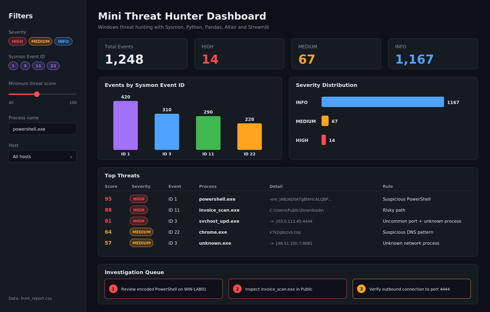

## Dashboard Demo


\# Mini Threat Hunter Dashboard


A Windows threat hunting project built with Sysmon, Python, Pandas, Altair, and Streamlit.


\## Features


\- Sysmon Event ID 1 - Process Create

\- Sysmon Event ID 3 - Network Connection

\- Sysmon Event ID 11 - File Create

\- Sysmon Event ID 22 - DNS Query

\- Threat scoring

\- Severity levels: INFO / MEDIUM / HIGH

\- Suspicious PowerShell detection

\- Risky path detection

\- Uncommon port detection

\- Unknown network process detection

\- Suspicious DNS pattern detection

\- Top Threats table

\- Investigation Queue

\- Interactive filters


\## Architecture


Sysmon

→ threat\_hunter.py

→ Threat Rules

→ Threat Score

→ hunt\_report.csv

→ dashboard.py

→ Streamlit Dashboard


\## Run


```powershell

python threat\_hunter.py

python -m streamlit run dashboard.py

